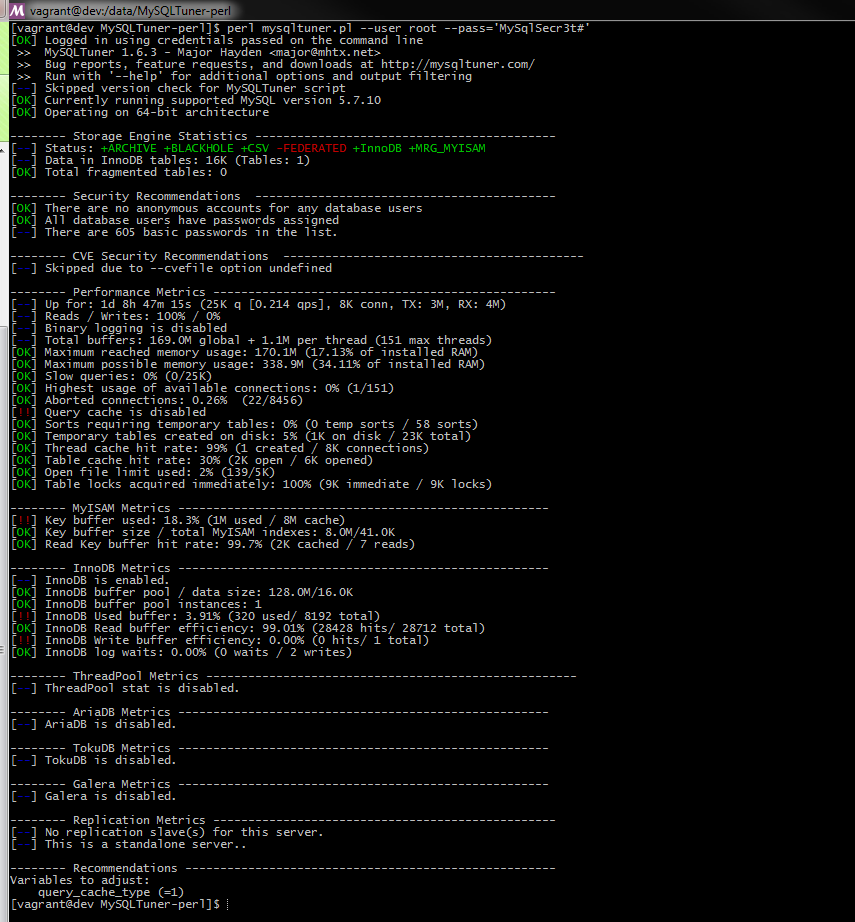

[English](README.md) | [Français](README.fr.md) | [Italiano](README.it.md) | [Русский](README.ru.md) | Tiếng Việt

[](mtlogo2.png)

[](https://github.com/major/MySQLTuner-perl)

[](https://opensource.box.com/badges) [](https://github.com/major/MySQLTuner-perl/releases/tag/v2.9.3) [](https://github.com/major/MySQLTuner-perl/actions) [](https://isitmaintained.com/project/major/MySQLTuner-perl "Thời gian trung bình để giải quyết một issue") [](https://isitmaintained.com/project/major/MySQLTuner-perl "Tỷ lệ issue còn mở") [](https://opensource.org/licenses/GPL-3.0/)

**MySQLTuner** là một script viết bằng Perl cho phép bạn xem xét nhanh một bản cài đặt MySQL và điều chỉnh để tăng hiệu năng và độ ổn định. Các biến cấu hình hiện tại và dữ liệu trạng thái được thu thập và trình bày ngắn gọn, kèm một số gợi ý cơ bản về hiệu năng.

Ở phiên bản mới nhất, **MySQLTuner** hỗ trợ hơn ~900 chỉ báo, KPI và khuyến nghị (bao gồm Điểm sức khỏe có trọng số, Lập kế hoạch dung lượng dự báo và Kiểm tra SSL/TLS) cho MySQL/MariaDB/Percona Server.

**MySQLTuner** được bảo trì tích cực và hỗ trợ nhiều cấu hình như [Galera Cluster](https://galeracluster.com/), [TokuDB](https://www.percona.com/software/mysql-database/percona-tokudb), [Performance schema](https://github.com/mysql/mysql-sys), số liệu hệ điều hành Linux, [InnoDB](https://dev.mysql.com/doc/refman/5.7/en/innodb-storage-engine.html), [MyISAM](https://dev.mysql.com/doc/refman/5.7/en/myisam-storage-engine.html), [Aria](https://mariadb.com/docs/server/server-usage/storage-engines/aria/aria-storage-engine), ...

Bạn có thể xem thêm chi tiết về các chỉ báo này tại đây: [Mô tả các chỉ báo](INTERNALS.md).

[](mysqltuner.png)

# Liên kết hữu ích

- **Phát triển chủ động:** <https://github.com/major/MySQLTuner-perl>
- **Bản phát hành/Tag:** <https://github.com/major/MySQLTuner-perl/tags>
- **Changelog:** <https://github.com/major/MySQLTuner-perl/blob/master/Changelog>
- **Docker Images:** <https://hub.docker.com/repository/docker/jmrenouard/mysqltuner/tags>
- **Tài liệu tham khảo hữu ích:** [Documentation/References](documentation/REFERENCES.md)
- **Hướng dẫn tích hợp AI Agent & MCP Server:** [Documentation/AI MCP Server Guide](documentation/mcp_ai_integration_guide.md) | [Guide Serveur MCP (FR)](documentation/mcp_ai_integration_guide.fr.md) | [AGENT.md](AGENT.md)
- **Báo cáo HTML tương tác (v2.9.0+):**
  * [Ví dụ báo cáo HTML E2E cho MariaDB 11.4](https://lightpath.fr/MySQLtuner_reports/MySQLTuner-v290_mariadb114/Schemadir/mysqltuner_report.html)
  * [Ví dụ báo cáo HTML E2E cho MySQL 8.4](https://lightpath.fr/MySQLtuner_reports/MySQLTuner-v290_mysql84/Schemadir/mysqltuner_report.html)
  * [Ví dụ báo cáo HTML E2E cho Percona 8.0](https://lightpath.fr/MySQLtuner_reports/MySQLTuner-v290_percona80/Schemadir/mysqltuner_report.html)

# MySQLTuner cần bạn

**MySQLTuner** cần người đóng góp về tài liệu, mã nguồn và phản hồi:

- Hãy tham gia cùng chúng tôi trên trình theo dõi issue tại [GitHub tracker](https://github.com/major/MySQLTuner-perl/issues).
- Hướng dẫn đóng góp có tại [Hướng dẫn đóng góp MySQLTuner](CONTRIBUTING.md)
- Hãy gắn sao cho **dự án MySQLTuner** tại [MySQLTuner Git Hub Project](https://github.com/major/MySQLTuner-perl/)
- Hỗ trợ có phí từ LightPath tại đây: [jmrenouard@lightpath.fr](mailto:jmrenouard@lightpath.fr)
- Hỗ trợ có phí từ Releem có tại đây: [Releem App](https://releem.com/)

### Nhà tài trợ

Việc phát triển chủ động được tài trợ bởi:

[](https://www.lightpath.fr)

Cảm ơn LightPath đã cung cấp tài nguyên (máy chủ dev, gói đăng ký AI, môi trường staging & tính năng).

[](https://github-readme-stats.vercel.app/api?username=jmrenouard&show_icons=true&theme=radical)

[](https://www.buymeacoffee.com/jmrenouard)

## Lịch sử sao (Star History)

[](https://star-history.dera.page/#major/MySQLTuner-perl&Date)

# Khả năng tương thích

Kết quả kiểm thử chỉ có cho các phiên bản LTS:

- MySQL (hỗ trợ đầy đủ)
- Percona Server (hỗ trợ đầy đủ)
- MariaDB (hỗ trợ đầy đủ)
- Galera replication (hỗ trợ đầy đủ)
- Percona XtraDB cluster (hỗ trợ đầy đủ)
- MySQL Replication (hỗ trợ một phần, không có môi trường kiểm thử)

Cảm ơn [endoflife.date](https://endoflife.date/)

- Tham khảo [Các phiên bản MariaDB được hỗ trợ](mariadb_support.md).
- Tham khảo [Các phiên bản MySQL được hỗ trợ](mysql_support.md).

***Hỗ trợ Windows ở mức một phần***

- Hiện đã hỗ trợ Windows
- Đã chạy MySQLtuner thành công trên WSL2 (Windows Subsystem for Linux)
- <https://docs.microsoft.com/en-us/windows/wsl/>

***CÁC MÔI TRƯỜNG CHƯA ĐƯỢC HỖ TRỢ - CẦN GIÚP ĐỠ***

***Trí tuệ nâng cao & hệ sinh thái***

- **KPI Điểm sức khỏe có trọng số**: Đánh giá tổng thể sức khỏe cơ sở dữ liệu (0-100) dựa trên Hiệu năng (40 điểm), Bảo mật (30 điểm) và Khả năng phục hồi (30 điểm).
- **Cố vấn di chuyển LTS thông minh**: Nhận diện rủi ro khi di chuyển lên các phiên bản LTS hiện đại (MySQL 8.4/9.0+, MariaDB 11.x), bao gồm các biến đã bị loại bỏ và các phương thức xác thực lỗi thời.
- **Lập kế hoạch dung lượng dự báo**: Phân tích khoảng trống bộ nhớ (đỉnh so với RAM+Swap khả dụng), dự báo tăng trưởng ổ đĩa và phát hiện AUTO_INCREMENT sắp chạm giá trị tối đa.
- **Tự động nhận diện đám mây**: Hỗ trợ gốc cho AWS RDS/Aurora, GCP Cloud SQL, Azure (Flexible/Managed) và DigitalOcean. Tự động phát hiện qua `@@version_comment` và các biến đặc thù của nhà cung cấp.
- **Tinh chỉnh theo hạ tầng**: Phát hiện loại lưu trữ SSD/NVMe so với HDD và kiến trúc ARM64/Graviton so với x86_64. Điều chỉnh khuyến nghị cho `innodb_flush_neighbors` và `innodb_io_capacity`.
- **Kiểm tra bảo mật SSL/TLS**: Kiểm tra mã hóa phiên, kiểm tra phiên bản TLS (cảnh báo với TLSv1.0/1.1), hạn dùng của chứng chỉ, bắt buộc `require_secure_transport` và kiểm tra SSL cho người dùng từ xa.
- **Kiểm tra plugin xác thực**: Phát hiện các plugin không an toàn (`mysql_native_password`, `sha256_password`), chẩn đoán mức sẵn sàng cho MySQL 9.x và khuyến nghị `ed25519`/`unix_socket` cho MariaDB.
- **Mô hình hóa lược đồ & quy ước đặt tên**: Phân tích toàn diện cấu trúc bảng (thiếu khóa chính, kiểu khóa thay thế, tuân thủ UTF-8, bảng không phải InnoDB), kiểm tra quy ước đặt tên (nhất quán snake_case/camelCase, phát hiện dạng số nhiều, tiền tố cột boolean/ngày) và phân tích khóa ngoại (các cột `_id` không có ràng buộc, kiểu dữ liệu không khớp, kiểm tra CASCADE).
- **Mô hình hóa MySQL 8.0+ / MariaDB**: Khả năng đánh chỉ mục cho cột JSON (cột sinh ảo), chỉ mục ẩn, ràng buộc CHECK.
- **Công cụ tự sửa có hướng dẫn**: Tạo sẵn các câu lệnh SQL `SET GLOBAL` và khối cấu hình `[mysqld]` có thể áp dụng ngay từ các khuyến nghị điều chỉnh biến.
- **Phân tích xu hướng lịch sử**: Nạp đầu ra JSON của các lần chạy trước qua `--compare-file` để theo dõi xu hướng QPS và tăng trưởng dữ liệu.
- **Tích hợp Sysbench**: Phân tích đầu ra sysbench để lấy các chỉ số QPS, TPS và độ trễ (Trung bình/95th/Tối đa) qua `--sysbench-file`.
- **Tích hợp log container & systemd**: Tự động phát hiện log từ Docker, Podman, Kubectl/Kubernetes và Systemd journal.
- **Hỗ trợ giao thức AI & MCP**: Daemon máy chủ Model Context Protocol (MCP) JSON-RPC qua stdio gốc và đầu ra có cấu trúc `--agent-json` cho các công cụ AI client (Claude Desktop, Cursor, VS Code / Cline, Antigravity).

---

## 🤖 Tích hợp AI Agent & Model Context Protocol (MCP)

MySQLTuner hỗ trợ gốc các quy trình trí tuệ nhân tạo (AI) hiện đại, các DBA agent tự chủ và trợ lý cho nhà phát triển (ví dụ: Claude Desktop, Cursor IDE, VS Code / Cline, Antigravity và các framework LangChain/LlamaIndex).

Để xem tài liệu kỹ thuật đầy đủ, hãy tham khảo [Hướng dẫn tích hợp AI & MCP](documentation/mcp_ai_integration_guide.md), [Guide Serveur MCP IA (FR)](documentation/mcp_ai_integration_guide.fr.md) và [AGENT.md](AGENT.md).

### Các chế độ hoạt động

1. **Telemetry CLI trực tiếp (`--agent-json`)**:
Xuất JSON có cấu trúc, không phụ thuộc thư viện, chứa các phát hiện, điểm tác động (`1`-`10`), mức rủi ro (`Low`, `Medium`, `High`, `Critical`), các câu lệnh SQL `SET GLOBAL` có thể thực thi và các baseline `rollback_statement` được tính sẵn.

   ```
   perl mysqltuner.pl --agent-json --host 127.0.0.1 --user root --pass secret
   ```

2. **Máy chủ Model Context Protocol (MCP)**:
Một microservice nhẹ ([build/mcp_server.py](build/mcp_server.py) và [Dockerfile.mcp](Dockerfile.mcp)) giao tiếp qua đầu vào/đầu ra chuẩn (stdio) bằng JSON-RPC 2.0.

   - **Resources**: `mysqltuner://reports/latest.json`, `mysqltuner://indicators/summary.json`
   - **Tools**: `get_latest_audit`, `run_audit`, `apply_recommendation`, `rollback_recommendation`

   ```
   docker run -d \
     --name mysqltuner-mcp \
     -e DB_HOST=127.0.0.1 -e DB_USER=root -e DB_PASSWORD=secret \
     mysqltuner-mcp
   ```

---

## ***Các storage engine chưa được hỗ trợ: hoan nghênh PR***

- NDB chưa được hỗ trợ, cứ thoải mái tạo Pull Request
- Archive
- Spider
- ColummStore
- Connect

## Những thứ không còn được MySQL hoặc MariaDB bảo trì

- MyISAM đã quá cũ và không còn được phát triển

- RockDB không còn được bảo trì

- TokuDB không còn được bảo trì

- XtraDB không còn được bảo trì

- Hỗ trợ phát hiện lỗ hổng CVE từ <https://cve.mitre.org>

***YÊU CẦU TỐI THIỂU***

- Perl 5.6 trở lên (kèm gói [perl-doc](https://metacpan.org/release/DAPM/perl-5.14.4/view/pod/perldoc.pod))
- Hệ điều hành dựa trên Unix/Linux (đã thử trên Linux, các biến thể BSD và các biến thể Solaris)
- Quyền đọc không hạn chế đối với máy chủ MySQL (xem Quyền hạn bên dưới)

## ***QUYỀN HẠN***

Để chạy MySQLTuner với đầy đủ tính năng, cần các quyền sau:

**MySQL 8.0+**:

```
GRANT SELECT, PROCESS, SHOW DATABASES, EXECUTE, REPLICATION REPLICA, REPLICATION CLIENT, SHOW VIEW ON *.* TO 'mysqltuner'@'localhost';
```

**MariaDB 10.5+**:

```
GRANT SELECT, PROCESS, SHOW DATABASES, EXECUTE, BINLOG MONITOR, SHOW VIEW, REPLICATION SOURCE ADMIN, REPLICA MONITOR ON *.* TO 'mysqltuner'@'localhost';
```

**Các phiên bản cũ**:

```
GRANT SELECT, PROCESS, EXECUTE, REPLICATION CLIENT, SHOW DATABASES, SHOW VIEW ON *.* TO 'mysqltuner'@'localhost';
```

Nên có quyền root của hệ điều hành đối với MySQL < 5.1

## ***CẢNH BÁO***

Bạn **cần** hiểu đầy đủ từng thay đổi mà mình thực hiện trên máy chủ cơ sở dữ liệu MySQL.
Nếu bạn không hiểu một số phần trong đầu ra của script, hoặc không hiểu các khuyến nghị,
**bạn nên tham khảo** một DBA hoặc quản trị viên hệ thống có hiểu biết mà bạn tin tưởng.
**Luôn luôn** kiểm thử các thay đổi trên môi trường staging, và luôn nhớ rằng
cải thiện ở một mặt có thể **ảnh hưởng xấu** đến MySQL ở những mặt khác.

Điều **quan trọng nữa** là phải đợi ít nhất 24 giờ uptime để có kết quả chính xác. Thực tế, chạy **mysqltuner** trên một máy chủ vừa khởi động lại là hoàn toàn vô ích.

**Hãy xem thêm phần FAQ bên dưới.**

## Khuyến nghị bảo mật

Xin chào người dùng directadmin!
Chúng tôi phát hiện bạn chạy mysqltuner với thông tin đăng nhập của da_admin lấy từ `/usr/local/directadmin/conf/my.cnf`, điều này có thể dẫn đến lộ mật khẩu!
Đọc liên kết để biết thêm chi tiết [Issue #289](https://github.com/major/MySQLTuner-perl/issues/289).

## MySQLTuner chính xác kiểm tra những gì?

Tất cả các kiểm tra do **MySQLTuner** thực hiện đều được mô tả trong tài liệu [MySQLTuner Internals](INTERNALS.md).

**MySQLTuner** phân tích các lĩnh vực sau:

- **Hệ thống & OS**: RAM, swap, cổng đang mở, tham số kernel, tải trung bình, điểm mount, card mạng
- **Phiên bản máy chủ**: phát hiện EOL, kiến trúc, khuyến nghị 64-bit
- **Log lỗi**: Tệp cục bộ, container Docker/Podman, pod Kubernetes, Systemd journal
- **Đám mây & hạ tầng**: AWS RDS/Aurora, GCP, Azure, DigitalOcean; SSD/NVMe so với HDD; ARM64/x86_64
- **Storage engine**: InnoDB (buffer pool, redo log, kích thước chunk), MyISAM, Aria, Galera, TokuDB, RocksDB
- **Bảo mật**: Người dùng ẩn danh, mật khẩu yếu, kiểm tra SSL/TLS, plugin xác thực, lỗ hổng CVE
- **Kết nối**: Tỷ lệ sử dụng, kết nối bị hủy, thread cache
- **Hiệu năng**: Sort/join/bảng tạm, bộ đệm toàn cục, query cache, truy vấn chậm, mức sử dụng bộ nhớ
- **Replication**: Trạng thái Source/Replica, độ trễ, GTID, semi-sync, multi-source
- **Performance Schema**: Top người dùng/host/câu lệnh, độ trễ IO, chờ khóa, chỉ mục không dùng, chỉ mục dư thừa
- **Mô hình hóa lược đồ**: Phân tích khóa chính, quy ước đặt tên, khóa ngoại, kiểu dữ liệu, tuân thủ UTF-8, khả năng đánh chỉ mục JSON
- **Dự báo**: Khoảng trống bộ nhớ, dự báo tăng trưởng ổ đĩa, dung lượng AUTO_INCREMENT
- **Điểm sức khỏe**: KPI có trọng số (0-100) tổng hợp các phát hiện về Hiệu năng, Bảo mật và Khả năng phục hồi

## Tải về/Cài đặt

> **Lưu ý:** Các gói của bản phân phối Linux (ví dụ `apt install mysqltuner` trên Ubuntu/Debian, `yum`/`dnf` trên RHEL/CentOS/Fedora) thường có phiên bản MySQLTuner cũ hơn đáng kể. Không có kho do bản phân phối bảo trì chính thức nào theo kịp bản phát hành mới nhất. Để luôn có phiên bản mới nhất, hãy dùng một trong các cách tải trực tiếp bên dưới.

Chọn một trong các cách sau:

1. Tải script trực tiếp (cách đơn giản và ngắn gọn nhất):

   ```
   wget https://mysqltuner.pl/ -O mysqltuner.pl
   wget https://raw.githubusercontent.com/major/MySQLTuner-perl/master/basic_passwords.txt -O basic_passwords.txt
   wget https://raw.githubusercontent.com/major/MySQLTuner-perl/master/vulnerabilities.csv -O vulnerabilities.csv
   ```

2. Bạn có thể tải toàn bộ repository bằng `git clone` hoặc `git clone --depth 1 -b master` theo sau là URL clone ở trên.

   ```
   git clone --depth 1 -b master https://github.com/major/MySQLTuner-perl.git
   ```

3. Trên Apple macOS, cài qua [Homebrew](https://brew.sh/):

   ```
   brew install mysqltuner
   ```

4. Nếu bạn ở trong **môi trường air-gapped** không có kết nối internet trực tiếp, hãy tải các tệp trên một máy có internet (hoặc qua một máy proxy), rồi sao chép `mysqltuner.pl`, `basic_passwords.txt` và `vulnerabilities.csv` sang máy chủ đích.

5. Docker: Pull và chạy container Docker chính thức (các tag trên Docker Hub có tại [jmrenouard/mysqltuner tags](https://hub.docker.com/r/jmrenouard/mysqltuner/tags?name=latest)):

   ```
   docker pull jmrenouard/mysqltuner:latest
   # Basic execution
   docker run --rm -it jmrenouard/mysqltuner --host <database_host> --user <username> --pass <password>

   # Save generated reports (HTML/TXT) to host filesystem:
   docker run --rm -it -v $(pwd)/results:/results jmrenouard/mysqltuner --host <database_host> --user <username> --pass <password>

   # Mount custom configuration / defaults file:
   docker run --rm -it -v $(pwd)/my.cnf:/defaults.cnf -v $(pwd)/results:/results jmrenouard/mysqltuner --host <database_host> --user <username> --pass <password>
   ```

### Vị trí các bản phát hành

- Ghi chú phát hành chính thức và lịch sử được lưu trong thư mục [releases/](releases) của repository này (ví dụ: [releases/v2.9.3.md](releases/v2.9.3.md)).
- Các Git tag và bản nén mã nguồn có thể tải xuống có trên [GitHub Releases](https://github.com/major/MySQLTuner-perl/releases).

## Cài đặt Sysschema tùy chọn cho MySQL 5.6

Sysschema được cài mặc định trên MySQL 5.7 và MySQL 8 của Oracle.
Theo mặc định, trên MySQL 5.6/5.7/8, performance schema được bật.
Với các phiên bản MySQL 5.6 trước đó, bạn có thể làm theo lệnh sau để tạo một database mới tên sys chứa các view rất hữu ích trên Performance schema:

## Sysschema cho MySQL phiên bản cũ

```
curl "https://codeload.github.com/mysql/mysql-sys/zip/master" > sysschema.zip
# check zip file
unzip -l sysschema.zip
unzip sysschema.zip
cd mysql-sys-master
mysql -uroot -p < sys_56.sql
```

## Sysschema cho MariaDB phiên bản cũ

```
curl "https://github.com/FromDual/mariadb-sys/archive/refs/heads/master.zip" > sysschema.zip
# check zip file
unzip -l sysschema.zip
unzip sysschema.zip
cd mariadb-sys-master
mysql -u root -p < ./sys_10.sql
```

## Thiết lập Performance schema

Theo mặc định, performance_schema được bật và sysschema được cài ở các phiên bản mới nhất.

Theo mặc định, trên MariaDB, performance schema bị tắt (MariaDB<10.6).

Hãy cân nhắc bật performance schema trong tệp cấu hình `my.cnf` của bạn:

```
[mysqld]
performance_schema = on
performance-schema-consumer-events-statements-history-long = ON
performance-schema-consumer-events-statements-history = ON
performance-schema-consumer-events-statements-current = ON
performance-schema-consumer-events-stages-current=ON
performance-schema-consumer-events-stages-history=ON
performance-schema-consumer-events-stages-history-long=ON
performance-schema-consumer-events-transactions-current=ON
performance-schema-consumer-events-transactions-history=ON
performance-schema-consumer-events-transactions-history-long=ON
performance-schema-consumer-events-waits-current=ON
performance-schema-consumer-events-waits-history=ON
performance-schema-consumer-events-waits-history-long=ON
performance-schema-instrument='%=ON'
max-digest-length=2048
performance-schema-max-digest-length=2018
```

## Cài đặt Sysschema cho MariaDB < 10.6

Sysschema không được cài mặc định trên MariaDB trước 10.6 [MariaDB sys](https://mariadb.com/kb/en/sys-schema/)

Bạn có thể làm theo lệnh sau để tạo một database mới tên sys chứa các view hữu ích trên Performance schema:

```
curl "https://codeload.github.com/FromDual/mariadb-sys/zip/master" > mariadb-sys.zip
# check zip file
unzip -l mariadb-sys.zip
unzip mariadb-sys.zip
cd mariadb-sys-master/
mysql -u root -p < ./sys_10.sql
```

## Lỗi & cách khắc phục khi cài đặt performance schema

## ERROR 1054 (42S22) at line 78 in file: './views/p_s/metrics_56.sql': Unknown column 'STATUS' in 'field list'

Lỗi này có thể bỏ qua an toàn.
Hãy cân nhắc dùng phiên bản MySQL/MariaDB mới hơn để tránh loại sự cố này khi cài đặt sysschema

Ở các phiên bản gần đây, sysschema được cài và tích hợp mặc định dưới dạng schema sys (SHOW DATABASES)

## ERROR at line 21: Failed to open file './tables/sys_config_data_10.sql -- ported', error: 2 Have a look at #452 solution given by @ericx

Sửa cấu hình sysctl (/etc/sysctl.conf)

--
Đây là thiết lập áp dụng cho toàn hệ thống chứ không phải thiết lập của cơ sở dữ liệu: [Linux FS Kernel settings](https://www.kernel.org/doc/html/latest/admin-guide/sysctl/fs.html#id1)

Bạn có thể kiểm tra giá trị của chúng bằng:

```
$ cat /proc/sys/fs/aio-*
65536
2305
```

Ví dụ, để đặt giá trị aio-max-nr, hãy thêm dòng sau vào tệp `/etc/sysctl.conf`:

```
fs.aio-max-nr = 1048576
```

Để kích hoạt thiết lập mới:

```
sysctl -p /etc/sysctl.conf
```

## Cách dùng cụ thể

**Cách dùng:** Dùng tối thiểu trên máy cục bộ

```
perl mysqltuner.pl --host 127.0.0.1
```

Tất nhiên, bạn có thể thêm quyền thực thi (`chmod +x mysqltuner.pl`) để chạy mà không cần gọi Perl trực tiếp.

**Cách dùng:** Dùng tối thiểu từ xa

Ở các phiên bản trước, phải đặt `--forcemem` thủ công để có thể chạy phân tích MySQLTuner

Kể từ 2.1.10, bộ nhớ và swap mặc định được đặt là 1Gb.

Nếu bạn muốn giá trị chính xác hơn tùy theo máy chủ từ xa, hãy thoải mái đặt `--forcemem` và `--forceswap` bằng giá trị RAM thực tế

```
perl mysqltuner.pl --host targetDNS_IP --user admin_user --pass admin_password
```

**Cách dùng:** Bật mức thông tin đầu ra tối đa về MySQL/MariaDb mà không bật gỡ lỗi

```
perl mysqltuner.pl --verbose
perl mysqltuner.pl --buffers --dbstat --idxstat --sysstat --pfstat --tbstat
```

**Cách dùng:** Bật kiểm tra lỗ hổng CVE cho phiên bản MariaDB hoặc MySQL của bạn

```
perl mysqltuner.pl --cvefile=vulnerabilities.csv
```

**Cách dùng:** Ghi kết quả vào tệp đồng thời vẫn hiển thị thông tin

```
perl mysqltuner.pl --outputfile /tmp/result_mysqltuner.txt
```

**Cách dùng:** Ghi kết quả vào tệp **mà không hiển thị thông tin ra màn hình**

```
perl mysqltuner.pl --silent --outputfile /tmp/result_mysqltuner.txt
```

**Cách dùng:** Tạo tệp báo cáo HTML độc lập (tích hợp sẵn, không cần CPAN hay module ngoài)

```
perl mysqltuner.pl --reportfile=mysqltuner.html
```

**Cách dùng:** Kết xuất tất cả view của information_schema và sysschema thành tệp csv vào thư mục con results

```
perl mysqltuner.pl --verbose --dumpdir=./result
```

**Cách dùng:** Bật thông tin gỡ lỗi

```
perl mysqltuner.pl --debug
```

**Cách dùng:** Cập nhật MySQLTuner và các tệp dữ liệu (mật khẩu và cve) nếu cần

```
perl mysqltuner.pl --checkversion --updateversion
```

**Cách dùng:** Tích hợp kết quả hiệu năng Sysbench

```
perl mysqltuner.pl --sysbench-file=/path/to/sysbench_output.txt
```

**Cách dùng:** Phân tích xu hướng lịch sử (so sánh với lần chạy trước)

```
perl mysqltuner.pl --json --outputfile=run1.json
# ... some time later ...
perl mysqltuner.pl --compare-file=run1.json
```

**Cách dùng:** Xuất một tệp Markdown cho mỗi schema (tài liệu hóa schema)

```
perl mysqltuner.pl --verbose --schemadir=./schemas
```

**Cách dùng:** Kết xuất dữ liệu có giới hạn số dòng và nén gzip

```
perl mysqltuner.pl --verbose --dumpdir=./result --dump-limit=10000 --compress-dump
```

**Cách dùng:** Chế độ container (phân tích cơ sở dữ liệu đang chạy trong Docker)

```
perl mysqltuner.pl --verbose --container docker:mysql_container_name
```

**Cách dùng:** Phân tích cấu trúc bảng và quy ước đặt tên

```
perl mysqltuner.pl --structstat
```

**Cách dùng:** Lọc đầu ra (chỉ hiển thị vấn đề)

```
perl mysqltuner.pl --nogood --noinfo
```

**Cách dùng:** Đầu ra JSON (cho tự động hóa và pipeline báo cáo)

```
perl mysqltuner.pl --json --outputfile=report.json
perl mysqltuner.pl --prettyjson
```

**Cách dùng:** Chế độ máy chủ không chuyên dụng (shared hosting)

```
perl mysqltuner.pl --nondedicated
```

**Cách dùng:** Phân tích nhanh bằng cách bỏ qua quét khối lượng công việc của bảng (Issue #986)

```
perl mysqltuner.pl --skipworkload
```

**Cách dùng:** Schema khắc phục cho AI Agent (JSON có thể hành động)

```
perl mysqltuner.pl --agent-json --outputfile=remediation.json
```

**Cách dùng:** Dùng thông tin đăng nhập từ biến môi trường

```
export MYSQL_USER=mysqltuner
export MYSQL_PASS=secret
perl mysqltuner.pl --userenv=MYSQL_USER --passenv=MYSQL_PASS
```

**Cách dùng:** Dùng tệp defaults tùy chỉnh

```
perl mysqltuner.pl --defaults-file=/path/to/my.cnf
```

Để xem danh sách đầy đủ các tùy chọn, hãy chạy `perl mysqltuner.pl --help` hoặc tham khảo tài liệu [USAGE.md](USAGE.md).

## Hỗ trợ đám mây

MySQLTuner hiện có hỗ trợ thử nghiệm cho các dịch vụ MySQL trên đám mây.

- `--cloud`: Bật chế độ đám mây. Đây là cờ chung cho mọi nhà cung cấp đám mây.
- `--azure`: Bật hỗ trợ riêng cho Azure.
- `--ssh-host <hostname>`: SSH host cho các kết nối đám mây.
- `--ssh-user <username>`: SSH user cho các kết nối đám mây.
- `--ssh-password <password>`: Mật khẩu SSH cho các kết nối đám mây.
- `--ssh-identity-file <path>`: Đường dẫn đến tệp định danh SSH cho các kết nối đám mây.

## Báo cáo HTML & Điểm sức khỏe có trọng số

MySQLTuner tính **KPI Điểm sức khỏe có trọng số** (đánh giá tổng thể sức khỏe cơ sở dữ liệu theo thang điểm từ 0 đến 100) một cách động dựa trên ba hạng mục:

1. **Hiệu năng (tối đa 40 điểm)**: Đánh giá hiệu quả đọc của buffer pool, tỷ lệ bảng tạm trên đĩa, tỷ lệ trúng thread cache và mức sử dụng kết nối.
2. **Bảo mật (tối đa 30 điểm)**: Đánh giá cấu hình tài khoản người dùng, mật khẩu yếu (kiểm tra ngoại tuyến), mã hóa phiên SSL/TLS và việc sử dụng plugin xác thực.
3. **Khả năng phục hồi (tối đa 30 điểm)**: Đánh giá trạng thái và độ trễ replication, thiết lập log và các phát hiện về mô hình hóa cơ sở dữ liệu.

**Tạo báo cáo HTML**

Bạn có thể tạo báo cáo HTML độc lập trực tiếp bằng:

   ```
   perl mysqltuner.pl --reportfile=mysqltuner.html
   ```

Tính năng này được xây dựng gốc bằng Perl thuần và **hoàn toàn không phụ thuộc thư viện ngoài** (không cần module CPAN hay gói Python). Báo cáo được tạo ra cung cấp một dashboard tương tác giao diện tối hiển thị:

- Đồng hồ đo Điểm sức khỏe tổng thể
- Phân tích chi tiết các chỉ số KPI (Hiệu năng, Bảo mật, Khả năng phục hồi)
- Danh sách khuyến nghị theo nhóm (Chung, Biến cần điều chỉnh, Mô hình hóa cơ sở dữ liệu, Bảo mật, Hệ thống)
- Log đầu ra console đầy đủ có thể thu gọn

## FAQ

**Câu hỏi: Điều kiện tiên quyết để chạy MySQL tuner là gì?**

Trước khi chạy MySQL tuner, bạn cần có:

- Một bản cài đặt máy chủ MySQL
- Perl đã được cài trên hệ thống
- Quyền quản trị đối với máy chủ MySQL

**Câu hỏi: MySQL tuner có thể tự động thay đổi cấu hình của tôi không?**

**Không.** MySQL tuner chỉ đưa ra khuyến nghị. Nó không tự động thay đổi bất kỳ tệp cấu hình nào. Người dùng tự xem xét các gợi ý và áp dụng khi cần.

**Câu hỏi: Tôi nên chạy MySQL tuner với tần suất bao nhiêu?**

Nên chạy MySQL tuner định kỳ, đặc biệt là sau những thay đổi đáng kể đối với máy chủ MySQL hoặc khối lượng công việc của nó.

Để có kết quả tối ưu, hãy chạy script sau khi máy chủ đã hoạt động ít nhất 24 giờ để thu thập đủ dữ liệu hiệu năng.

**Câu hỏi: Làm thế nào để diễn giải kết quả từ MySQL tuner?**

MySQL tuner đưa ra đầu ra dưới dạng các gợi ý và cảnh báo.

Hãy xem xét từng khuyến nghị và cân nhắc áp dụng các thay đổi vào tệp cấu hình MySQL của bạn (thường là `my.cnf` hoặc `my.ini`).

Hãy thận trọng khi thay đổi và luôn sao lưu tệp cấu hình trước khi chỉnh sửa.

**Câu hỏi: MySQL tuner có thể gây hại cho cơ sở dữ liệu hoặc máy chủ của tôi không?**

Bản thân MySQL tuner sẽ không thay đổi gì trên máy chủ của bạn, nhưng việc áp dụng mù quáng các khuyến nghị của nó mà không hiểu tác động có thể gây ra sự cố.

Luôn bảo đảm bạn hiểu hệ quả của từng gợi ý trước khi áp dụng lên máy chủ.

**Câu hỏi: MySQL tuner có hỗ trợ MariaDB và Percona Server không?**

Có, MySQL tuner hỗ trợ MariaDB và Percona Server vì chúng là các nhánh phái sinh của MySQL và có kiến trúc tương tự. Script có thể phân tích và đưa ra khuyến nghị cho các hệ thống này.

**Câu hỏi: Tôi nên làm gì nếu cần trợ giúp về MySQL tuner hoặc có thắc mắc về các khuyến nghị?**

Nếu bạn cần trợ giúp về MySQL tuner hoặc có câu hỏi về các khuyến nghị do script đưa ra, bạn có thể tham khảo tài liệu của MySQL tuner, tìm lời khuyên trên các diễn đàn trực tuyến hoặc hỏi một chuyên gia MySQL.

Hãy thận trọng khi áp dụng thay đổi để bảo đảm sự ổn định và hiệu năng của máy chủ.

**Câu hỏi: MySQLTuner có sửa được máy chủ MySQL chậm của tôi không?**

**Không.** MySQLTuner là một script chỉ đọc. Nó sẽ không ghi vào bất kỳ tệp cấu hình nào, cũng không thay đổi trạng thái của bất kỳ daemon nào. Nó sẽ cho bạn cái nhìn tổng quan về hiệu năng máy chủ và đưa ra một số khuyến nghị cơ bản mà bạn có thể thực hiện sau khi nó chạy xong.

**Câu hỏi: Bây giờ tôi có thể sa thải DBA của mình chưa?**

**MySQLTuner sẽ không thay thế DBA của bạn dưới bất kỳ hình thức nào.**

Nếu DBA của bạn lúc nào cũng chiếm chỗ đậu xe và ăn trộm bữa trưa của bạn trong tủ lạnh thì có lẽ bạn nên cân nhắc — nhưng đó là quyết định của bạn.

Sau khi tạo tệp, hãy bảo đảm nó thuộc sở hữu của người dùng của bạn và quyền truy cập trên tệp là `0600`. Điều này sẽ ngăn những ánh mắt tò mò nhìn thấy thông tin đăng nhập cơ sở dữ liệu của bạn trong điều kiện bình thường.

**Câu hỏi: Tôi gặp "ERROR 1524 (HY000): Plugin 'unix_socket' is not loaded" dù đã đặt unix_socket=OFF. Cách khắc phục?**

Lỗi này xảy ra vì MariaDB client mặc định cố dùng plugin `unix_socket` khi không cung cấp user/mật khẩu.

- **Giải pháp 1 (Khuyến nghị):** Dùng tệp `~/.my.cnf` như mô tả ở trên để cung cấp thông tin đăng nhập tường minh.
- **Giải pháp 2:** Truyền trực tiếp thông tin đăng nhập: `perl mysqltuner.pl --user root --pass your_password`.

**Câu hỏi: Làm thế nào để bật lại xác thực `unix_socket` một cách an toàn?**

Nếu bạn quyết định dùng `unix_socket` (cho phép người dùng `root` của hệ điều hành đăng nhập vào `root` của MariaDB mà không cần mật khẩu), hãy làm theo các bước sau:

1. Bảo đảm plugin được bật trong `/etc/my.cnf`: `unix_socket=ON` (hoặc xóa `OFF`).

2. Trong MariaDB, đặt plugin xác thực cho người dùng root:

   ```
   ALTER USER 'root'@'localhost' IDENTIFIED VIA unix_socket;
   ```

3. Xác minh plugin `auth_socket` hoặc `unix_socket` đang ở trạng thái `ACTIVE` trong `SHOW PLUGINS`.

**Câu hỏi: Có cách nào khác để bảo vệ thông tin đăng nhập trên các bản phân phối MySQL và MariaDB mới nhất không?**

Bạn có thể dùng các tiện ích mysql_config_editor.

   ```
   $ mysql_config_editor set --login-path=client --user=someusername --password --host=localhost
   Enter password: ********
   ```

Sau đó, `~/.mylogin.cnf` sẽ được tạo với quyền truy cập phù hợp.

Để xem thông tin về thông tin đăng nhập đã lưu, dùng lệnh sau:

   ```
   $mysql_config_editor print
   [client]
   user = someusername
   password = *****
   host = localhost
   ```

**Câu hỏi: Nó không chạy được trên hệ điều hành của tôi! Chuyện gì vậy?!**

Những chuyện kiểu này khó tránh khỏi. Đây là các thông tin tôi cần từ bạn để điều tra sự cố:

- Hệ điều hành và phiên bản hệ điều hành
- Kiến trúc (x86, x86_64, IA64, Commodore 64)
- Phiên bản MySQL chính xác
- Nơi bạn lấy phiên bản MySQL (gói của OS, mã nguồn, v.v.)
- Toàn văn thông báo lỗi
- Bản sao đầu ra của `SHOW VARIABLES` và `SHOW GLOBAL STATUS` (nếu có thể)

**Câu hỏi: Làm thế nào để kiểm tra lỗ hổng CVE?**

- Tải vulnerabilities.csv từ repository này.
- Dùng tùy chọn `--cvefile` để thực hiện kiểm tra CVE

**Câu hỏi: Làm thế nào để dùng mysqltuner từ một máy từ xa?** Cảm ơn [@rolandomysqldba](https://dba.stackexchange.com/users/877/rolandomysqldba)

- Bạn vẫn phải kết nối như một mysql client:

Kết nối và xác thực

   ```
   --host <hostname> Connect to a remote host to perform tests (default: localhost)
   --socket <socket> Use a different socket for a local connection
   --port <port>     Port to use for connection (default: 3306)
   --user <username> Username to use for authentication
   --pass <password> Password to use for authentication
   --defaults-file <path> defaults file for credentials
   ```

Vì bạn đang dùng máy từ xa, hãy dùng các tham số để cung cấp giá trị từ hệ điều hành

   ```
   --forcemem <size>  Amount of RAM installed (in megabytes or with units, e.g. 15G, 1024M)
   --forceswap <size> Amount of swap memory configured (in megabytes or with units)
   ```

- Bạn có thể phải liên hệ quản trị viên hệ thống từ xa để hỏi họ có bao nhiêu RAM và swap

Nếu cơ sở dữ liệu có quá nhiều bảng, hoặc bảng rất lớn, hãy dùng:

   ```
   --skipsize           Don't enumerate tables and their types/sizes (default: on)
                        (Recommended for servers with many tables)
   ```

**Câu hỏi: Tôi có thể cài dự án này bằng homebrew trên Apple Macintosh không?**

Có! Có thể dùng `brew install mysqltuner` để cài ứng dụng này bằng [homebrew](https://brew.sh/) trên Apple Macintosh.

**Câu hỏi: Tôi đã cài MySQLTuner qua trình quản lý gói của bản phân phối Linux (apt/yum/dnf). Làm sao để lấy phiên bản mới nhất?**

Các bản phân phối Linux như Ubuntu, Debian, RHEL và CentOS thường có phiên bản MySQLTuner cũ hơn trong kho chính thức của họ. Ví dụ, Ubuntu 22.04 có phiên bản 1.7.17 trong khi bản mới nhất có thể mới hơn đáng kể.

Hiện **không có kho APT/YUM/DNF chính thức** nào theo kịp bản phát hành MySQLTuner mới nhất. Để có phiên bản mới nhất, hãy dùng một trong các cách sau:

- **Tải trực tiếp (khuyến nghị):**

   ```
   wget https://mysqltuner.pl/ -O mysqltuner.pl
   wget https://raw.githubusercontent.com/major/MySQLTuner-perl/master/basic_passwords.txt -O basic_passwords.txt
   wget https://raw.githubusercontent.com/major/MySQLTuner-perl/master/vulnerabilities.csv -O vulnerabilities.csv
   chmod +x mysqltuner.pl
   ```

- **Git clone:**

   ```
   git clone --depth 1 -b master https://github.com/major/MySQLTuner-perl.git
   cd MySQLTuner-perl
   perl mysqltuner.pl
   ```

- **Môi trường air-gapped:** Nếu máy chủ của bạn không có kết nối internet trực tiếp, hãy tải các tệp ở trên trên một máy có internet (hoặc qua proxy), rồi chuyển `mysqltuner.pl`, `basic_passwords.txt` và `vulnerabilities.csv` sang máy chủ đích bằng `scp`, `rsync` hoặc phương pháp truyền tệp khác.

## MySQLTuner và Vagrant (Legacy)

> **Lưu ý:** Môi trường kiểm thử dựa trên Vagrant được coi là legacy. Để kiểm thử hiện đại, hãy dùng bộ kiểm thử dựa trên Docker qua `make test-it` hoặc `build/test_envs.sh`.

**Tệp Vagrant** được lưu trong thư mục con Vagrant.

## Thiết lập môi trường kiểm thử Docker

MySQLTuner có hạ tầng kiểm thử dựa trên Docker để xác thực trên nhiều phiên bản:

```
# Create and start all test containers
sh build/createTestEnvs.sh

# Source environment helpers
source build/bashrc

# Connect to a specific database
mysql_percona80 sakila
```

**Các mục tiêu kiểm thử được hỗ trợ** (tham khảo [hỗ trợ MariaDB](mariadb_support.md) và [hỗ trợ MySQL](mysql_support.md) để xem ma trận tương thích hiện tại):

- MySQL 8.0, 8.4, 9.x
- MariaDB 10.6, 10.11, 11.4, 11.8
- Percona Server 8.0

## Hoan nghênh đóng góp

Làm thế nào để đóng góp bằng Pull Request? Hãy làm theo hướng dẫn này: [Tạo pull request](https://opensource.com/article/19/7/create-pull-request-github)

## Các bước đơn giản để tạo một pull request

- Fork dự án GitHub này
- Clone nó về máy cục bộ
- Tạo một nhánh mới
- Thực hiện các thay đổi của bạn
- Push ngược lại về repo của bạn
- Nhấn nút Compare & pull request
- Nhấn Create pull request để mở một pull request mới
